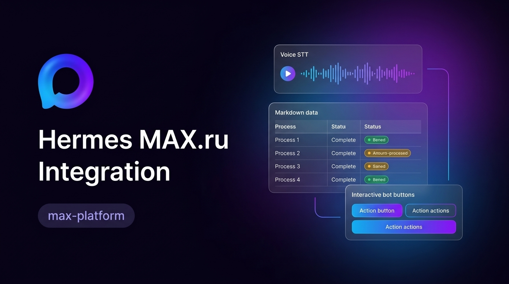

# Hermes MAX Gateway



**Ваш агент Hermes — в MAX.** Потоковые ответы, голосовые сообщения, интерактивные кнопки и файлы; дополнительно — панель сессий в Desktop.

[English](README.md) · [Установка](docs/setup_RU.md) · [Changelog](CHANGELOG_RU.md)

[](LICENSE)
[](docs/setup_RU.md)
[](pyproject.toml)

## ✨ Возможности

| | Возможность | В вашем чате |
|---|---|---|
| 💬 | **Потоковые ответы** | Постепенные правки, индикаторы ввода и разбиение длинных сообщений |
| 🔘 | **Интерактивное управление** | Выбор модели, подтверждение команд, варианты clarify, включая Other |
| 📎 | **Нативные вложения** | Изображения, видео, аудио и документы; ответы агента только с файлом получают подпись с его именем |
| 🎤 | **Голосовые сообщения** | Скачивание и передача в Hermes Core STT; распознавание настраивается в Core |
| 📊 | **Читаемые таблицы** | Необязательный Markdown → PNG: Playwright/Chromium с резервным Pillow |
| 📡 | **Два транспорта** | Long polling по умолчанию либо HTTPS webhook с проверкой секрета |
| 🔒 | **Управление доступом** | Списки пользователей/групп и проверка владельца callback |
| 🖥️ | **Desktop-компаньон** | Панель сессий MAX, английский по умолчанию и русская локализация |

Необязательные кросс-платформенные `/sessions` и `/resume` требуют явной авторизации владельца. См. [поведение функций](docs/features_RU.md).

## 🚀 Быстрый старт

Требуются **Hermes Core ≥0.21.4** и **Python ≥3.12**. Закреплённые minimum/baseline/current версии Core указаны в [инструкции установки](docs/setup_RU.md).

```bash
hermes plugins install Realmagnum/hermes-max-integration --enable
hermes gateway setup
```

Создайте бота по официальной [инструкции MAX](https://dev.max.ru/docs/chatbots/bots-create); настройка запросит `MAX_BOT_TOKEN` и правила доступа. Long polling не требует публичного endpoint. Для webhook задайте `MAX_WEBHOOK_URL` и `MAX_WEBHOOK_SECRET` с публичным HTTPS. **Перед сменой режима проверьте подписки:** запуск polling пытается удалить прежние webhooks.

Конфигурация, дополнительные зависимости и работа на сервере: [установка](docs/setup_RU.md). Не сохраняйте токены и секреты в Git.

## 📊 Таблицы, которые удобно читать

Включите `MAX_TABLE_AS_IMAGE=true`, чтобы получать Markdown-таблицы в виде PNG для пересылки. Рендерер устанавливается в Python-окружение gateway; [настройка и резервный рендер](docs/features_RU.md).

**Исходная таблица:**

```markdown
| Server   | Status | Load | IP       |
|----------|--------|------|----------|
| web-01   | ✓ OK   | 23%  | 10.0.1.10 |
| web-02   | ✓ OK   | 67%  | 10.0.1.11 |
| db-main  | ✗ Down | 0%   | 10.0.2.5  |
| cache-01 | ⚠ High | 92%  | 10.0.3.1  |
```

**Пример картинки, доставляемой в MAX:**


Подходит для списков задач, мониторинга и отчётов. Рендер необязателен; картинка иллюстрирует функцию, а не результат живого мониторинга.

## 📎 Отправка файла

Попросите агента создать и отправить файл. Он возвращает `MEDIA:<absolute-file-path>` в финальном ответе; gateway загружает вложение. Без авторского текста плагин добавляет имя файла либо `File`, если имя недоступно. Пользователь подтвердил живую доставку файла 2026-10-14.

Прямой `hermes send` и пути cron без output hook по-прежнему требуют текста: `report.pdf MEDIA:/path/report.pdf`. См. [контракты подписей](docs/specs/20261013-media-caption_RU.md).

## ⌨️ Slash-команды

При возможности регистрируются 20 команд; ошибка регистрации не мешает работе.

**Основные:** `/start`, `/new` (`/reset`), `/status`, `/model`, `/resume`, `/sessions`, `/help`, `/stop`, `/config`, `/restart`.

**Дополнительные:** `/retry`, `/undo [N]`, `/title [name]`, `/branch` (`/fork`), `/compress` (`/compact`), `/rollback [number]`, `/background` (`/bg`, `/btw`), `/agents` (`/tasks`), `/queue` (`/q`), `/topic`.

## 🛡️ Безопасность и совместимость

- Токены привязаны к активному профилю Hermes; webhook и callbacks проверяются с отказом при отсутствии подтверждения. Скачивание медиа сохраняет allowlist хостов и защиту от SSRF.
- Российский корневой сертификат Russian Trusted Root CA расширяет доверие **только клиентов MAX API/upload**. Скачивание вложений использует стандартное доверие TLS.
- Локальные медиа остаются в `HERMES_HOME`. Нет телеметрии и кода автообновления плагина. API endpoint: `MAX_API_BASE` (`https://platform-api2.max.ru`); официальные медиа-хосты: `*.max.ru`, `*.oneme.ru`.
- Аудит закреплённых в CI зависимостей Core сообщает 14 advisories PyJWT 2.13.0. Ограничение upstream остаётся открытым; исключения аудита и несовместимые подмены не используются.

Подробности: [безопасность](docs/security_RU.md), [датированные проверки совместимости](docs/external-claims_RU.md) и [оставшиеся задачи](BACKLOG_RU.md). Изменения после `v2.10.2` **ещё не выпущены**; см. [changelog](CHANGELOG_RU.md).

## 📚 Подробнее

| Задача | Документ |
|---|---|
| Установить, настроить, найти причину сбоя | [Установка](docs/setup_RU.md) · [Диагностика](docs/troubleshooting_RU.md) |
| Разобраться в поведении и устройстве | [Возможности](docs/features_RU.md) · [Архитектура](docs/architecture_RU.md) · [API](docs/api_RU.md) |
| Разработать или проверить изменение | [Micro-Spec](docs/micro-spec-development_RU.md) · [Контракты каталога](docs/specs/20261013-catalog-review-137501_RU.md) · [Backlog](BACKLOG_RU.md) |

`scripts/diagnose.sh --send` отправляет реальное сообщение; используйте только одобренного адресата. Локальные проверки и запуск тестов описаны в [инструкции установки](docs/setup_RU.md).

## Лицензия и благодарности

[MIT](LICENSE) · Для [Hermes Agent](https://hermes-agent.nousresearch.com/docs), на основе архитектурной отправной точки [hermes-max-platform](https://github.com/vladimiraldushin/hermes-max-platform).
